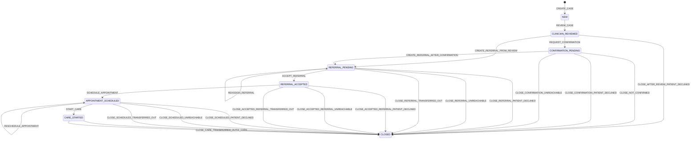

# System Architecture

CareLoop is a modular monolith. HTTP controllers validate requests against `@careloop/shared`, then call services. Services use the pure state-machine evaluator before writing case state, immutable events, and audit entries together through Prisma transactions. The Next.js client calls the Express REST API; PostgreSQL is reachable only from the Compose network.

```mermaid
flowchart LR
  Browser[Next.js client] -->|JSON REST /api/v1| API[Express API]
  API --> Auth[Authentication and RBAC]
  API --> Services[Domain services]
  Services --> Machine[Pure transition evaluator]
  Services --> Core[Clock, event log, audit]
  Services --> Prisma[Prisma data access]
  Prisma --> DB[(PostgreSQL)]
  Shared[@careloop/shared schemas] -. validates .-> API
  Shared -. transition keys/evidence .-> Machine
```

The workflow policy is kept in a single TypeScript table. The following section is generated from `server/src/core/stateMachine/transitionTable.ts`; regenerate it with `npm run docs:state-machine` after changing the policy.

<!-- BEGIN GENERATED STATE MACHINE -->

## Lifecycle state diagram


## Transition policy table

| Key | From → to | Roles and provider scope | Required facts | Evidence fields | Closure | Owner after | Due-at rule | Notification | Event |
| --- | --- | --- | --- | --- | --- | --- | --- | --- | --- |
| CREATE_CASE | none → NEW | DOCTOR: OWN_PROVIDER<br>ADMIN: ANY | None | patientId, originProviderId, pathway, screeningType, resultCategory, preliminarySummary, recommendedAction, intakeUrgency | — | User from evidence.assignedDoctorId (otherwise unassigned) | reviewAfterNew from now | None | CASE_CREATED |
| REVIEW_CASE | NEW → CLINICIAN_REVIEWED | DOCTOR: OWN_PROVIDER | caseAssignedToDoctor, approvedExplanationExists | approvedExplanationIds | — | COORDINATOR queue at origin provider | notificationDispatch from now | result_reviewed | CASE_REVIEWED |
| REQUEST_CONFIRMATION | CLINICIAN_REVIEWED → CONFIRMATION_PENDING | COORDINATOR: OWN_PROVIDER | resultReviewedDispatched | None | — | DOCTOR queue at origin provider | confirmatoryResult from now | awaiting_confirmation | CONFIRMATION_REQUESTED |
| CREATE_REFERRAL_FROM_REVIEW | CLINICIAN_REVIEWED → REFERRAL_PENDING | COORDINATOR: SENDING_PROVIDER | resultReviewedDispatched | toProviderId, referralReason | — | COORDINATOR queue at receiving provider | referralAcceptance from now | referral_started | REFERRAL_CREATED |
| CLOSE_AFTER_REVIEW_PATIENT_DECLINED | CLINICIAN_REVIEWED → CLOSED | DOCTOR: OWN_PROVIDER | patientDeclineRecorded | closureReason=PATIENT_DECLINED, documentedReason, closureProposalId? | PATIENT_DECLINED | None | None | care_closed | CASE_CLOSED |
| CREATE_REFERRAL_AFTER_CONFIRMATION | CONFIRMATION_PENDING → REFERRAL_PENDING | DOCTOR: OWN_PROVIDER | confirmatoryResultExists | toProviderId, referralReason | — | COORDINATOR queue at receiving provider | referralAcceptance from now | referral_started | REFERRAL_CREATED |
| CLOSE_NOT_CONFIRMED | CONFIRMATION_PENDING → CLOSED | DOCTOR: OWN_PROVIDER | confirmatoryResultExists | closureReason=NOT_CONFIRMED, documentedReason, closureProposalId? | NOT_CONFIRMED | None | None | care_closed | CASE_CLOSED |
| CLOSE_CONFIRMATION_PATIENT_DECLINED | CONFIRMATION_PENDING → CLOSED | DOCTOR: OWN_PROVIDER | patientDeclineRecorded | closureReason=PATIENT_DECLINED, documentedReason, closureProposalId? | PATIENT_DECLINED | None | None | care_closed | CASE_CLOSED |
| CLOSE_CONFIRMATION_UNREACHABLE | CONFIRMATION_PENDING → CLOSED | DOCTOR: OWN_PROVIDER | failedContactAttemptsForMilestone, escalationEventExists | closureReason=UNREACHABLE_AFTER_ATTEMPTS, documentedReason, closureProposalId? | UNREACHABLE_AFTER_ATTEMPTS | None | None | care_closed | CASE_CLOSED |
| ACCEPT_REFERRAL | REFERRAL_PENDING → REFERRAL_ACCEPTED | DOCTOR: RECEIVING_PROVIDER<br>COORDINATOR: RECEIVING_PROVIDER | currentReferralExists | referralId | — | COORDINATOR queue at receiving provider | appointmentScheduling from now | referral_accepted | REFERRAL_ACCEPTED |
| REASSIGN_REFERRAL | REFERRAL_PENDING → REFERRAL_PENDING | COORDINATOR: SENDING_PROVIDER | currentReferralExists, currentReferralReassignable | toProviderId, referralReason, rejectionReason? | — | COORDINATOR queue at receiving provider | referralAcceptance from now | referral_reassigned | REFERRAL_REASSIGNED |
| CLOSE_REFERRAL_PATIENT_DECLINED | REFERRAL_PENDING → CLOSED | DOCTOR: ORIGIN_OR_RECEIVING | patientDeclineRecorded | closureReason=PATIENT_DECLINED, documentedReason, closureProposalId? | PATIENT_DECLINED | None | None | care_closed | CASE_CLOSED |
| CLOSE_REFERRAL_UNREACHABLE | REFERRAL_PENDING → CLOSED | DOCTOR: ORIGIN_OR_RECEIVING | failedContactAttemptsForMilestone, escalationEventExists | closureReason=UNREACHABLE_AFTER_ATTEMPTS, documentedReason, closureProposalId? | UNREACHABLE_AFTER_ATTEMPTS | None | None | care_closed | CASE_CLOSED |
| CLOSE_REFERRAL_TRANSFERRED_OUT | REFERRAL_PENDING → CLOSED | DOCTOR: ORIGIN_OR_RECEIVING | None | closureReason=TRANSFERRED_OUT, documentedReason, closureProposalId?, externalProviderName, facilityContact, handoverSummary | TRANSFERRED_OUT | None | None | care_closed | CASE_CLOSED |
| SCHEDULE_APPOINTMENT | REFERRAL_ACCEPTED → APPOINTMENT_SCHEDULED | COORDINATOR: RECEIVING_PROVIDER | currentReferralExists, currentReferralAccepted | scheduledAt, location | — | COORDINATOR queue at receiving provider | appointmentAttendanceGrace from scheduled_at | appointment_scheduled | APPOINTMENT_SCHEDULED |
| CLOSE_ACCEPTED_REFERRAL_PATIENT_DECLINED | REFERRAL_ACCEPTED → CLOSED | DOCTOR: ORIGIN_OR_RECEIVING | patientDeclineRecorded | closureReason=PATIENT_DECLINED, documentedReason, closureProposalId? | PATIENT_DECLINED | None | None | care_closed | CASE_CLOSED |
| CLOSE_ACCEPTED_REFERRAL_UNREACHABLE | REFERRAL_ACCEPTED → CLOSED | DOCTOR: ORIGIN_OR_RECEIVING | failedContactAttemptsForMilestone, escalationEventExists | closureReason=UNREACHABLE_AFTER_ATTEMPTS, documentedReason, closureProposalId? | UNREACHABLE_AFTER_ATTEMPTS | None | None | care_closed | CASE_CLOSED |
| CLOSE_ACCEPTED_REFERRAL_TRANSFERRED_OUT | REFERRAL_ACCEPTED → CLOSED | DOCTOR: ORIGIN_OR_RECEIVING | None | closureReason=TRANSFERRED_OUT, documentedReason, closureProposalId?, externalProviderName, facilityContact, handoverSummary | TRANSFERRED_OUT | None | None | care_closed | CASE_CLOSED |
| START_CARE | APPOINTMENT_SCHEDULED → CARE_STARTED | DOCTOR: RECEIVING_PROVIDER | attendedAppointmentExists | carePlan, followUpAt | — | DOCTOR queue at receiving provider | defaultFollowUpInterval from follow_up_at | care_started | CARE_STARTED |
| RESCHEDULE_APPOINTMENT | APPOINTMENT_SCHEDULED → APPOINTMENT_SCHEDULED | COORDINATOR: RECEIVING_PROVIDER | currentAppointmentExists, appointmentMissedOrRescheduleRequested | scheduledAt, location, delayReason | — | COORDINATOR queue at receiving provider | appointmentAttendanceGrace from scheduled_at | appointment_rescheduled | APPOINTMENT_RESCHEDULED |
| CLOSE_SCHEDULED_PATIENT_DECLINED | APPOINTMENT_SCHEDULED → CLOSED | DOCTOR: ORIGIN_OR_RECEIVING | patientDeclineRecorded | closureReason=PATIENT_DECLINED, documentedReason, closureProposalId? | PATIENT_DECLINED | None | None | care_closed | CASE_CLOSED |
| CLOSE_SCHEDULED_UNREACHABLE | APPOINTMENT_SCHEDULED → CLOSED | DOCTOR: ORIGIN_OR_RECEIVING | failedContactAttemptsForMilestone, escalationEventExists | closureReason=UNREACHABLE_AFTER_ATTEMPTS, documentedReason, closureProposalId? | UNREACHABLE_AFTER_ATTEMPTS | None | None | care_closed | CASE_CLOSED |
| CLOSE_SCHEDULED_TRANSFERRED_OUT | APPOINTMENT_SCHEDULED → CLOSED | DOCTOR: ORIGIN_OR_RECEIVING | None | closureReason=TRANSFERRED_OUT, documentedReason, closureProposalId?, externalProviderName, facilityContact, handoverSummary | TRANSFERRED_OUT | None | None | care_closed | CASE_CLOSED |
| CLOSE_COMPLETED_CARE | CARE_STARTED → CLOSED | DOCTOR: RECEIVING_PROVIDER | attendedAppointmentExists | closureReason=COMPLETED_CARE, documentedReason, closureProposalId?, careCompletionSummary, postTreatmentFindings?, surveillancePlan? | COMPLETED_CARE | None | None | care_closed | CASE_CLOSED |
| CLOSE_CARE_TRANSFERRED_OUT | CARE_STARTED → CLOSED | DOCTOR: RECEIVING_PROVIDER | None | closureReason=TRANSFERRED_OUT, documentedReason, closureProposalId?, externalProviderName, facilityContact, handoverSummary | TRANSFERRED_OUT | None | None | care_closed | CASE_CLOSED |

<!-- END GENERATED STATE MACHINE -->

## Resolved decisions

- Before a referral exists (`CLINICIAN_REVIEWED` and `CONFIRMATION_PENDING`), only a DOCTOR from the originating provider may close. From `REFERRAL_PENDING` through `APPOINTMENT_SCHEDULED`, either an originating-provider DOCTOR or current receiving-provider DOCTOR may close; the receiving provider requires active consent when it differs from the origin. In `CARE_STARTED`, only a receiving-provider DOCTOR may close, including `CLOSE_CARE_TRANSFERRED_OUT`.
- Entering `CONFIRMATION_PENDING` keeps the case's assigned doctor as the user owner. If no doctor is assigned, ownership falls back to the originating provider's DOCTOR queue.
- The evaluator actor includes the authenticated `userId`. Every `CLOSE_*` result contains `CLINICIAN_SIGN_OFF` derived evidence naming that user and the server supplied `now` timestamp.
- `START_CARE.followUpAt` is optional. When omitted, dueAt defaults to now + 30 days. When supplied, it must be in the future and no more than 180 days ahead; dueAt is the supplied date.
- Appointment attendance grace is 2 days for both routine and urgent cases. `SCHEDULE_APPOINTMENT` and `RESCHEDULE_APPOINTMENT` set dueAt to scheduledAt + 2 days using the centralized `appointmentAttendanceGrace` configuration.
