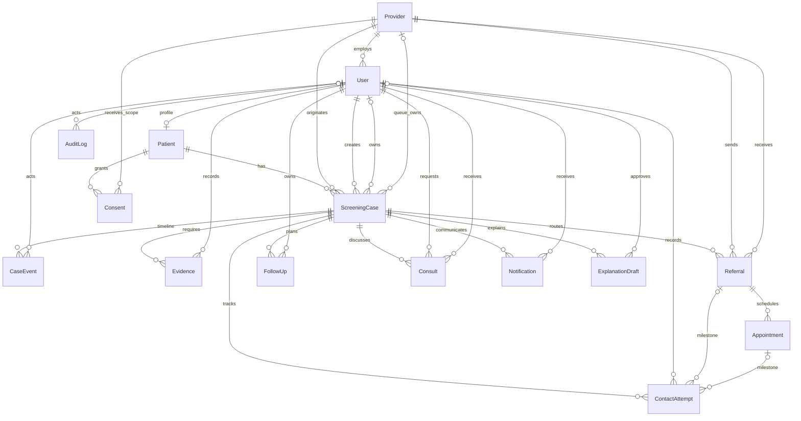

# CareLoop database design

This first schema stores the lifecycle state and the records needed to explain each handoff. `CaseEvent` is the patient timeline; `AuditLog` records security and administrative actions. Both logs are immutable at the PostgreSQL layer. Overdue status and attention level are derived by queries; only the configured case `dueAt` and escalation overlay are stored.

## Entity relationship diagram

A case owner is one user **or** one role/provider queue. Both may be absent for an explicitly unassigned open case; PostgreSQL checks reject simultaneous user and queue ownership and incomplete queue ownership. `CLOSED` cases must have a closure reason and timestamp, and have no owner or due date.

## Tables

- **User** — login identity, role, provider affiliation, and preferred language. `Patient` is a one-to-one profile for patient users.
- **Provider** — simulated screening centre, hospital, or clinic. It anchors provider-scoped access, case origin, referral routing, queue ownership, and consent.
- **Patient** — synthetic MRN, date of birth, preferred language/channel, and the patient account link.
- **ScreeningCase** — one actionable screening result and its current state, clinical approval fields, owner, due date, acknowledgement timestamps, escalation level, escalation start time, and closure facts. `escalatedAt` is set while the case is above `LEVEL_0` and cleared at `LEVEL_0`; its PostgreSQL sequence generates public IDs such as `CL-1001` (starting at 1001).
- **CaseEvent** — append-only lifecycle and in-state events, with optional state endpoints, actor type and user actor ID, timestamp, and structured payload. System events use `actorType = SYSTEM`; user events require a user actor ID.
- **Evidence** — structured supporting records for transitions and closure decisions, attributed to the user who recorded them.
- **Referral** — a provider-to-provider handoff with `respondedAt` recording when the receiving provider accepts or rejects it. Reassignment creates a new row; the former row can be retained as `SUPERSEDED` with any rejection reason intact.
- **Appointment** — scheduled, attended, missed, or rescheduled appointment attached to a referral. It has a nullable `delayReason` for appointment-specific context.
- **ContactAttempt** — outreach channel and outcome tied to a case milestone and, when applicable, its referral or appointment. This makes failed attempts queryable for the current milestone.
- **FollowUp** — an owned action and due date during care. Its status is `OPEN`, `COMPLETED`, or `CANCELLED`.
- **Consult** — patient-to-clinician or clinician-to-clinician question, response, participants, and status.
- **Notification** — in-app outbox entry with recipient, channel label, language, template key, and queued/sent timestamps; it does not store clinical message text.
- **ExplanationDraft** — localized template/LLM output and its draft/approval state, including the approving clinician and approval time.
- **Consent** — patient authorization for a receiving provider and scope, retained as a grant/revocation record rather than overwritten.
- **AuditLog** — append-only record of actor type, optional user actor ID, action, entity type/id, and time for security and administrative auditing. `SYSTEM` identifies automation; `USER` requires an actor ID.

## Enum contract

The enums `Role`, `ActorType`, `CaseState`, `FollowUpStatus`, `Urgency`, `ClosureReason`, `EscalationLevel`, `ReferralStatus`, `AppointmentStatus`, `ConsultKind`, `ConsultStatus`, `ExplanationStatus`, `ExplanationSource`, `Language`, `ProviderType`, `ContactChannel`, `ContactOutcome`, `NotificationStatus`, `ConsentScope`, `DelayReason`, `NotificationTemplateKey`, and `CaseEventType` use the agreed names and values. `AttentionLevel` and overdue are not database fields.

`EvidenceKind` is proposed from the lifecycle and closure evidence descriptions in spec sections 1.1 and 1.3:

| Proposed value | Evidence represented |
|---|---|
| `SCREENING_INTAKE` | Screening type, finding category, preliminary summary, recommended action, and intake urgency. |
| `APPROVED_CLINICAL_PLAN` | Clinician-approved summary, next step, urgency, and route. |
| `APPROVED_EXPLANATION` | Explanation reviewed and approved by a clinician. |
| `CONFIRMATION_TASK_CREATED` | Confirmatory task and its routing. |
| `NOTIFICATION_DISPATCHED` | Required patient notification dispatch. |
| `REFERRAL_CREATED` | New referral and receiving provider. |
| `CONSENT_VERIFIED` | Active cross-provider consent used for a referral. |
| `PATIENT_DECLINE` | Patient refusal and documented discussion/reason. |
| `CONFIRMATORY_RESULT` | Confirmatory diagnostic result, including a negative/normal result. |
| `REFERRAL_ACCEPTANCE` | Receiving provider acceptance. |
| `REFERRAL_REJECTION` | Rejection and required reason. |
| `REFERRAL_REASSIGNMENT` | New referral row, selected provider, and reassignment count. |
| `APPOINTMENT_SCHEDULED` | Appointment date, time, location, and provider. |
| `APPOINTMENT_ATTENDED` | Attendance recorded by the receiving coordinator. |
| `APPOINTMENT_MISSED` | Missed appointment record. |
| `DELAY_REASON` | Required reason for a reschedule, missed appointment, or SLA breach. |
| `CONTACT_ATTEMPTS` | Contact attempt history supporting an unreachable closure. |
| `ESCALATION_RECORD` | Escalation trail supporting an unreachable closure or action. |
| `UNREACHABLE_STATUS` | Final unreachable status documentation. |
| `EXTERNAL_TRANSFER` | External destination, receiving facility, and handover summary. |
| `CARE_PLAN` | Treatment or ongoing surveillance plan. |
| `CARE_COMPLETION` | Completed treatment, post-treatment findings, or completed surveillance evidence. |
| `CLINICIAN_SIGN_OFF` | Clinician closure decision/sign-off. |
| `CLOSURE_PROPOSAL` | Coordinator's proposed closure rationale and evidence. |

## Index rationale

- `ScreeningCase(state, dueAt)` supports state worklists and query-time overdue filtering. `ownerUserId` and `(ownerQueueRole, ownerQueueProviderId)` support the user and queue ownership worklists.
- `CaseEvent(caseId, createdAt)` loads a case timeline in chronological order. Actor/time supports audit review.
- `Notification(userId, status)` supports a patient's queued/sent inbox. `(caseId, createdAt)` supports the case communication history.
- `Referral(caseId)` is the required lookup for referral history by case; receiving/sending provider status indexes support provider queues.
- Patient/provider case indexes support patient history and provider-scoped lists. Referral, appointment, contact attempt, follow-up, consult, consent, explanation, and audit indexes align with their owner/status/time or parent-record lookups.
- Unique indexes on user email, patient user, synthetic MRN, provider name, and explanation `(caseId, language, createdAt)` prevent duplicate identities and duplicate drafts at the same timestamp for one language.

## Append-only enforcement

Prisma has no schema syntax for PostgreSQL triggers or check constraints. The generated initial migration is created with `prisma migrate dev --create-only`; its SQL is amended to create the public-ID sequence and the owner, closure, reassignment, referral, appointment, contact, notification, explanation, and consult checks. A follow-up SQL migration requires `dueAt` for every open case. The custom append-only migration installs `BEFORE UPDATE OR DELETE` triggers on `CaseEvent` and `AuditLog` and also rejects `TRUNCATE`. The shared trigger function raises SQLSTATE `55000` for any such mutation.

## Seed plan

No seed script is included in T-002. The planned seed data is synthetic and should provide:

- One screening-centre provider, at least two receiving providers (for example, a hospital and clinic), and accounts for all four roles. Include two doctors affiliated with different providers, one coordinator, one admin, and at least one patient.
- Cases distributed across `NEW`, `CLINICIAN_REVIEWED`, `CONFIRMATION_PENDING`, `REFERRAL_PENDING`, `REFERRAL_ACCEPTED`, `APPOINTMENT_SCHEDULED`, `CARE_STARTED`, and `CLOSED`, with routine/urgent urgency, user/queue/unassigned ownership, pending/rejected/superseded referrals, appointments, consent, explanation, evidence, notifications, and events sufficient to demonstrate the workflow.
- Only fabricated names, MRNs, dates, case findings, and account credentials. Use sequence-generated case IDs; do not hard-code IDs that conflict with `CL-1001` onward.

## Resolved decisions

1. **Actor attribution:** `ActorType` is `USER` or `SYSTEM` on both `CaseEvent` and `AuditLog`. `actorId` remains nullable for system actions; a database check requires a non-null `actorId` whenever `actorType = USER`. New rows default to `USER`. During migration, pre-existing rows with no `actorId` are classified as `SYSTEM`.
2. **Follow-up status:** `FollowUpStatus` is `OPEN`, `COMPLETED`, or `CANCELLED`; `FollowUp.status` uses this enum and defaults to `OPEN`.
3. **Delay reasons:** `Appointment.delayReason` is nullable. The API must require a delay reason for corrective actions on overdue cases and store it in the `DELAY_REASON_RECORDED` event payload. This keeps the reason with the corrective action in the append-only timeline.
4. **Escalation and referral response timestamps:** `ScreeningCase.escalatedAt` is set when `escalationLevel` rises above `LEVEL_0` and cleared when it returns to `LEVEL_0`; it supports the LEVEL_3 timer for LEVEL_2 cases uncleared for 48 hours. `Referral.respondedAt` is set when accepted or rejected; it starts the rejected-referral reassignment window and anchors the time-to-referral-acceptance metric.

## Spec issues

1. A `ContactAttempt` can identify its referral or appointment and has the case id/milestone state, but the specification does not state a database rule requiring those referenced rows to belong to the same case. The application must create milestone links from the current case; a composite foreign-key rule can be added if the API contract requires database-level enforcement.
2. The closure table requires `CLOSED` to be terminal and unowned with no due date, while the original lifecycle table does not spell out the `closedAt`, owner, and due-date database invariant. The schema encodes the closure requirements in a check constraint to make the explicit closure rules enforceable.
